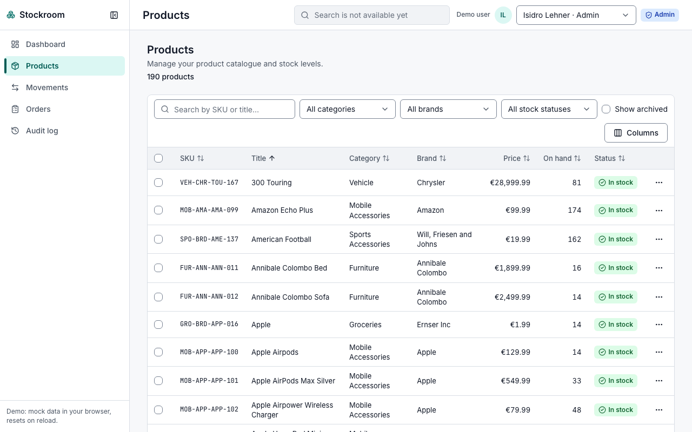
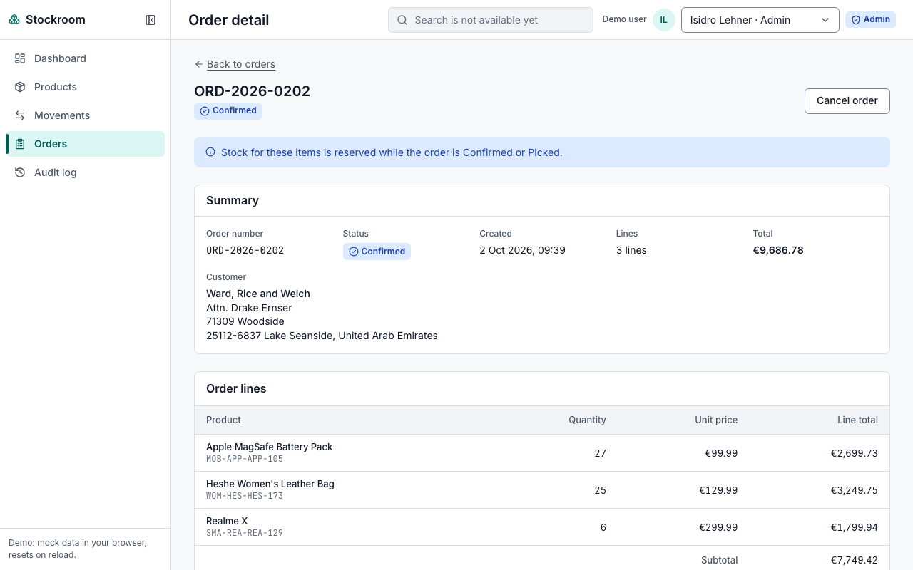
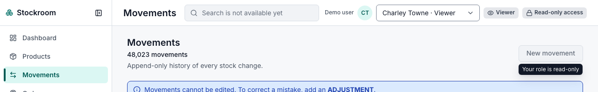
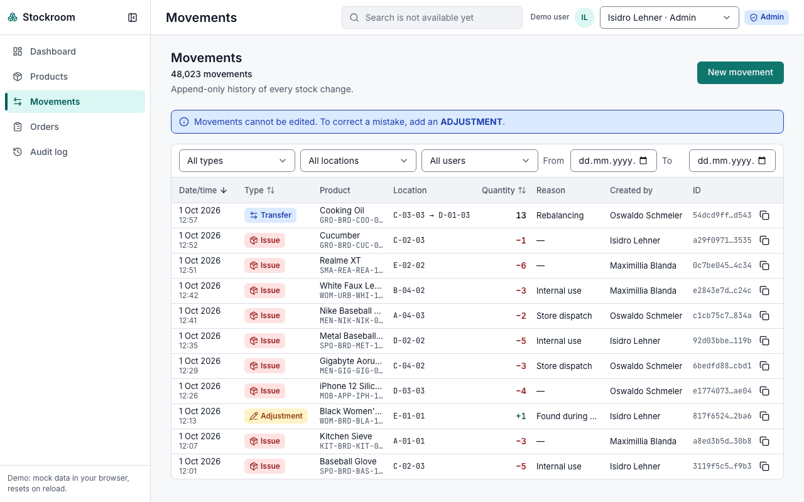
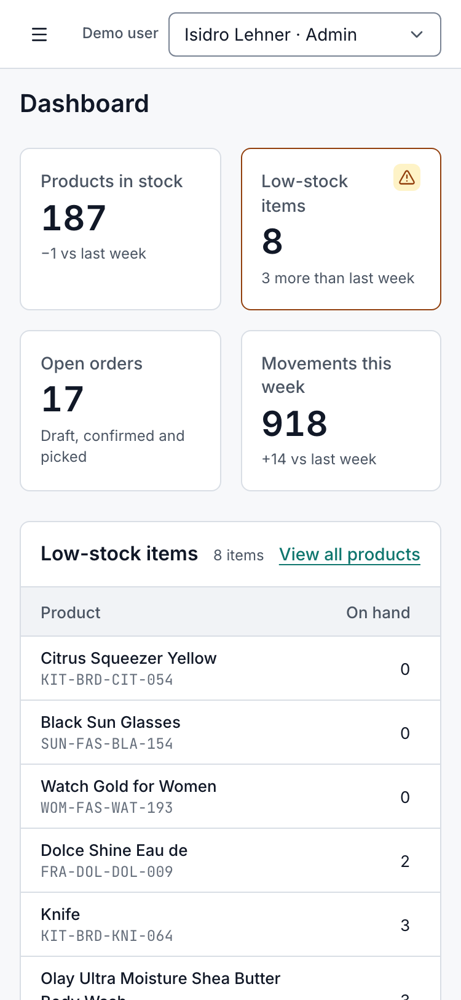

# Stockroom

An inventory and orders app for a small warehouse, where stock levels are derived from an append-only log of stock movements.

**Live demo:** https://stockroom-web-five.vercel.app



## About the demo

The demo has no backend. A mock API ([MSW](https://mswjs.io/)) runs in a service worker in your browser and answers every request from data generated on the spot from a fixed seed, so everyone sees the same warehouse. Changes you make are kept until you reload the page; a reload starts from the seed again. The sidebar says so too.

This repository is phase 1 of three: the frontend against a mocked API. Phase 2 (a real API with a database and auth, behind the same contract) and phase 3 (Docker and CI) are not built. The plan is in [`context/project-overview.md`](context/project-overview.md).

## What it does

| Screen       | What you can do                                                                                                                       |
| ------------ | ------------------------------------------------------------------------------------------------------------------------------------- |
| Dashboard    | Four KPI cards and the products that are low on stock                                                                                 |
| Products     | Search, filter, sort and page through the catalog; select rows; update the category or archive; create a stock adjustment; export CSV |
| Movements    | Scroll the full movement history (48,023 rows in the seed) and filter it; record a new movement and undo it                           |
| Orders       | Search and filter orders by status and date                                                                                           |
| Order detail | Lines, totals with VAT, and the reservation note; cancel the order                                                                    |
| Audit log    | Every movement, order event and role change (48,090 rows in the seed) with filters                                                    |

Counts are as the app shows them on 2026-10-27; the seed also holds 190 active products and 26 orders.

**Stock is a projection of an append-only movement log.** There is no stored stock number: on-hand quantities are computed from receipts, issues, transfers and adjustments, and availability is on hand minus what confirmed and picked orders reserve ([ADR-0003](docs/adr/0003-stock-reservation.md)). A movement cannot be edited or deleted; Undo posts a reversing movement. Orders and products are stored as their current state.



### Roles

A role switcher in the top bar picks a demo user. It is a demo control, not a login.

|                                               | ADMIN | CLERK | VIEWER |
| --------------------------------------------- | :---: | :---: | :----: |
| View every screen, filter, sort, export CSV   |  yes  |  yes  |  yes   |
| Record a movement, create an adjustment, undo |  yes  |  yes  |   no   |
| Cancel an order                               |  yes  |  yes  |   no   |
| Update a product's category, archive products |  yes  |  no   |   no   |

A control the current role may not use stays visible and focusable. Its reason ("Your role is read-only", "Only an admin can do this") shows on hover, keyboard focus and tap, and is read by screen readers.



## Design decisions

- **Contract first.** Every endpoint, request, response and URL query is a Zod schema in [`packages/contract`](packages/contract/src). Types are inferred from the schemas, the mock API is written against them, and the client parses each response with them. Table filters in the URL go through the same schemas, so an invalid parameter falls back to its default.
- **Permissions in one place.** [`can(user, action)`](packages/domain/src/permissions.ts) in `packages/domain` is a pure function over a role matrix. The UI and the mock API both call it; neither repeats a rule ([ADR-0004](docs/adr/0004-clerk-permissions.md)).
- **Visible reasons for disabled controls.** A disabled control explains itself to every user, not only to screen readers, through one shared `Button` ([spec](context/features/007_02-disabled-reason-spec.md)).
- **Virtualized lists.** Movements and the audit log load pages of 100 rows as you scroll and render only the rows in view, inside a real `<table>` with `aria-rowcount` and `aria-rowindex` ([ADR-0006](docs/adr/0006-virtualization.md)). With 10,000 loaded rows the list mounts in 28.7 ms instead of 4,705.9 ms and keeps 648 elements instead of 274,042 ([measurement](docs/performance/movements-virtualization.md)).

  

- **Own table engine.** Sorting, filtering and paging happen in the API, so the generic `DataTable<T, S>` only renders rows, typed columns, selection and the accessible markup. A headless table library would have needed an adapter about as large as that code ([ADR-0005](docs/adr/0005-table-engine.md)).
- **Server state and client state apart.** TanStack Query owns everything that comes from the API, including the optimistic "Saving…" row of a new movement and its exact rollback when the server refuses it. Redux Toolkit holds only the toast queue with its Undo offers ([ADR-0002](docs/adr/0002-state-management.md)).
- **Mock API in the browser.** The demo is a static site; the same seed and handlers serve the tests. Hosting, routing and caching are described in [`docs/deploy.md`](docs/deploy.md).

## Quality



- **Unit and component tests:** Vitest and React Testing Library, 1,153 tests in 90 files on 2026-10-27 (contract 78, domain 253, seed 13, web app 809). Component tests find elements by role and label and run against the mock API.
- **End-to-end tests:** Playwright in Chromium against the production build, at 1280 px and 375 px: 147 passed on 2026-10-27 (86 desktop, 61 mobile), plus one that runs only against a deployed site. axe reports zero violations on every route at both widths, per role on screens with guarded controls, and in the loading, empty and error states. What the suite covers: [`docs/testing.md`](docs/testing.md).
- **Storybook** with the a11y addon: stories for the shared atoms, molecules and organisms and for each screen's view.
- **Lighthouse on the live site,** 2026-10-27, Lighthouse 13.5.0, mobile preset with simulated throttling, median of 5 runs ([details](docs/performance/production-lighthouse.md)):

|             | Performance | Accessibility | Best Practices |  SEO |   CLS |      TBT |
| ----------- | ----------: | ------------: | -------------: | ---: | ----: | -------: |
| `/products` |        0.62 |          1.00 |           1.00 | 1.00 | 0.022 | 1,700 ms |
| `/orders`   |        0.62 |          1.00 |           1.00 | 1.00 | 0.023 | 1,679 ms |

Total Blocking Time is high, about 1.7 s, and it is what holds Performance at 0.62. Nearly all of it is one long task in the mock chunk (928 kB, 336 kB gzipped): on the first request it generates the whole seed, twelve months of movements, orders and audit events, and builds the in-memory store on the main thread. A real backend would not do that work in the browser.

## Tech stack

- TypeScript (strict), React 19, Vite, pnpm workspaces
- React Router in data mode ([ADR-0001](docs/adr/0001-router.md))
- TanStack Query, TanStack Virtual, Redux Toolkit
- react-hook-form and Zod
- SCSS Modules with design tokens as CSS custom properties
- MSW and `@faker-js/faker` for the mock API and seed
- Vitest, React Testing Library, Playwright with axe, Storybook, oxlint

## Run it locally

Prerequisites: Node.js 24 and pnpm 12.9.1 through Corepack (the version is pinned in the root `package.json`).

```
corepack enable
pnpm install
pnpm dev                 # the app on http://localhost:5173
```

Other commands, all from the repository root:

```
pnpm test                # Vitest across the workspace
pnpm lint                # oxlint
pnpm typecheck           # tsc across the workspace
pnpm build               # typecheck and production build of the app
pnpm storybook           # Storybook on http://localhost:6006

# end-to-end tests: install the browser once, then run the suite
pnpm --filter @stockroom/web exec playwright install chromium
pnpm e2e
```

`pnpm e2e` builds the app and serves it with `vite preview` on port 4173. If a preview is already running there, the suite reuses it, so stop it after changing the app.

Add `?mock=slow`, `?mock=empty` or `?mock=error` to any URL to see the loading, empty and error states.

## Repository layout

```
apps/web            the React app, its components, stories and tests, and the mock API (src/mocks)
packages/contract   Zod schemas and inferred types for every endpoint and URL query
packages/domain     pure TypeScript rules: stock projection, availability, movement validation,
                    order totals and status machine, permissions
packages/seed       deterministic data: a product catalog snapshot and a seeded simulation
                    of a year of movements and orders
docs/adr            architecture decision records
docs/               deployment, testing and performance notes
context/features    feature specs
```

`packages/domain` has no React, browser APIs or I/O, and packages never import from `apps/`.

## Known limitations

- **Mock data only.** No backend, no database, no authentication. The role switcher stands in for a login.
- **Not every action is built.** Orders can be cancelled but not created, edited, confirmed, picked or shipped in the UI (the state machine for those is in `packages/domain`). Products cannot be created. The top bar search is a placeholder.
- **Service workers are required.** Where the browser blocks them, as some private windows do, the demo shows a "could not start" page instead of the app.
- **Total Blocking Time** of about 1.7 s on a simulated mid-range phone, from generating the seed in the browser (see [Quality](#quality)).
- **Small layout shifts remain** (CLS about 0.02 per route): the filter options notice, the role switcher width, table column widths, and a web font swap on first paint ([details](docs/performance/production-lighthouse.md#remaining-layout-shifts)).
- **End-to-end tests run in Chromium only.** Firefox and WebKit are not tested; touch behaviour in Safari is checked by hand.
- **Virtualized lists** render only the rows near the view, so the browser's find in page does not see the others ([limits](docs/performance/movements-virtualization.md#known-limits-of-the-virtualized-table)).
- **No CI.** The checks (lint, typecheck, tests, build) run locally before each merge.

## License

[MIT](LICENSE), © 2026 Martin Vukalović.
